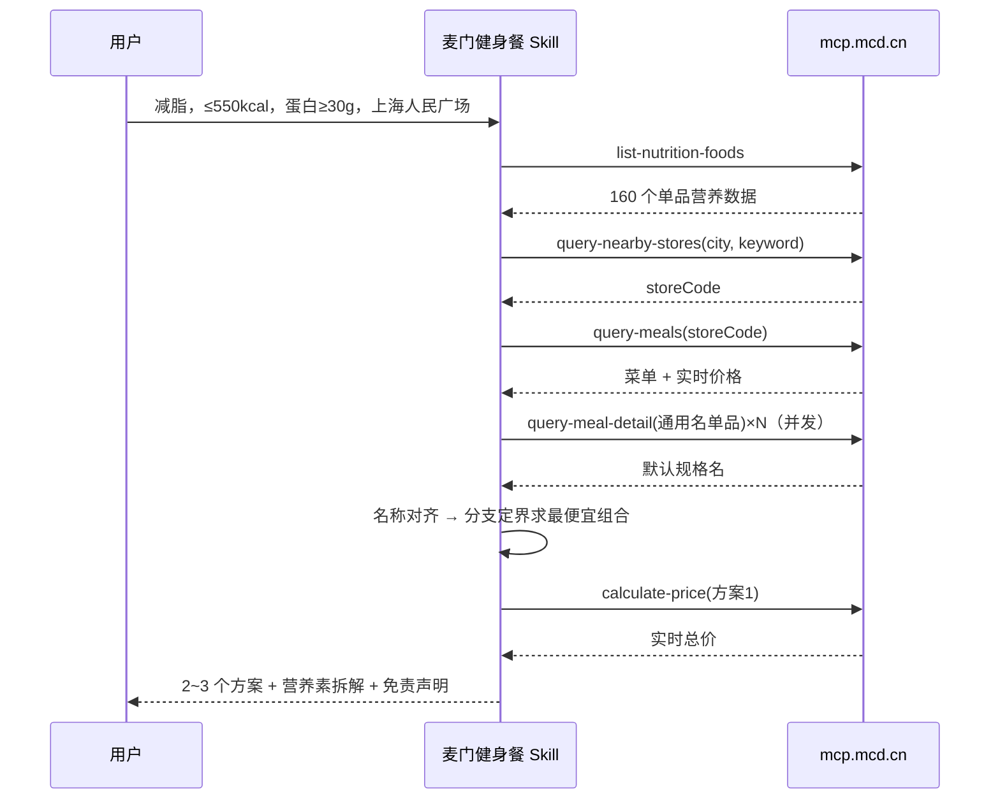

# MCP 集成说明

## 使用的 MCP Server

| 项目 | 值 |
|---|---|
| 名称 | 麦当劳中国 MCP Server（mcd-mcp） |
| 地址 | `https://mcp.mcd.cn` |
| 传输 | Streamable HTTP（JSON-RPC 2.0，支持 SSE 响应） |
| 鉴权 | `Authorization: Bearer ${MCD_MCP_TOKEN}`（仅环境变量，见 `mcp-config.example.json`） |

## 使用的 Tool（全部只读）

| Tool | 用途 | 关键参数 |
|---|---|---|
| `list-nutrition-foods` | 获取官方营养表：能量、蛋白质、脂肪、碳水、钠、钙 | 无 |
| `query-nearby-stores` | 按城市+关键词找到店自取门店，拿 `storeCode` | `beType=1, searchType=2, city, keyword` |
| `query-meals` | 门店菜单与实时价格 `currentPrice` | `storeCode, orderType=1, beType=1` |
| `query-meal-detail` | 解析"可乐/牛奶/薯条"等通用名的默认规格，用于和营养表对齐 | `storeCode, code` |
| `calculate-price` | 校验最终方案实时总价（单位：分） | `storeCode, items[{productCode, quantity}]` |
| `query-store-coupons` / `available-coupons` | （Skill 中可选）提示可用/可领优惠券，只展示不代领 | `storeCode` / 无 |

本项目**不调用**任何写操作（下单、领券、抽奖、地址创建等）。

## 调用流程

## 数据对齐细节

- `list-nutrition-foods` 的 `data` 是表格文本（首行 `[N]{字段...}:`），由 `mcd_fitness/data.py::parse_nutrition` 解析并去重。
- 菜单名与营养名归一化：统一中英文括号、去掉引号、`-`、`™`；`XX套餐` 尝试匹配 `XX`（对应"500 大卡套餐"栏目）；`那么大鸡排（椒盐风味）` 去括号后匹配。
- 通用名（如 `牛奶`）调用 `query-meal-detail` 得到默认规格 `热牛奶中杯` 后再匹配。
- 件套/双人餐等组合套餐没有整体营养数据，不估算、直接跳过，保证推荐里的每个数字都来自官方。

## 业务价值

- **把营养数据变成点餐决策**：官方营养表 + 实时价格 → "满足目标的最便宜组合"，降低健身人群"吃麦当劳会不会破功"的顾虑。
- **拉新与复购**：减脂/增肌用户原本会主动回避快餐，这个 Skill 给出可执行的方案，让他们有理由走进门店。
- **带动高蛋白单品**：推荐结果天然偏向板烧鸡腿堡、薄皮系列鸡翅、双层牛堡等高蛋白餐品，以及 500 大卡套餐栏目。
- **门店级精确价格**：基于 `storeCode` 和 `calculate-price`，结果可直接用于下单流程（下单需用户确认）。
